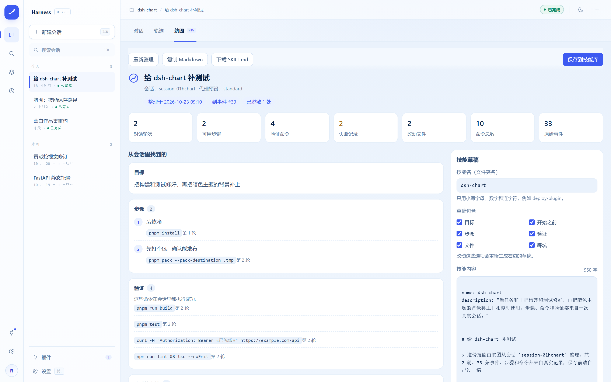

# 航图 · dsh-chart

**这次会话里跑通的东西，一键变成下次能直接用的技能。**

**中文** · [English](README.en.md)

## 先看一个场景

有些活你每周都要干一遍：发布插件、跑数据库迁移、把设计稿切回项目里。每一次都得重新摸索一遍命令，试错半小时，才算想起来上回是怎么做的。

而就在上一次会话里，这套动作其实已经**真的跑通了**——命令执行成功了，测试过了，构建过了。只是它跟着聊天记录一起滚走了。

**航图负责把它捡回来。** 打开一个聊过天的会话，点「航图」标签，它从会话日志里挑出真正跑通的步骤、真正通过的验证、最后改好的文件和踩过的坑，写成一份 `SKILL.md`——就是 DeepSeek Harness 能直接加载的技能文件。存进技能库之后，下次遇到相似任务，Harness 会带着这份经验开工。

不额外调用模型，不猜内容。草稿里每一条，都能对回那次会话里的一条事件。

## 长这样



> 界面预览，用的是示例会话：左边是从日志里数出来的证据，右边是生成的技能草稿。

保存之前，你看到的是这样一份普通 Markdown：

```markdown
---
name: dsh-chart
description: "当任务和「把构建和测试修好，再把暗色主题的背景补上」相似时使用：
  步骤、命令和验证都来自一次真实会话。"
---

# 给 dsh-chart 补测试

> 这份技能由航图从会话 `session-01hchart` 整理，共 2 轮、33 条事件。
> 步骤和命令都来自真实记录，保存前请自己过一遍。

## 步骤
1. 装依赖 —— `pnpm install`（第 1 轮）
2. 先打个包，确认能发布 —— `pnpm pack --pack-destination .tmp`（第 2 轮）

## 验证
- `pnpm run build`
- `pnpm test`
- `npm run lint && tsc --noEmit`
```

## 什么进技能，什么不进

| 会话里发生过 | 航图怎么处理 |
| --- | --- |
| `pnpm test` 执行成功 | 进步骤，也进验证 |
| `npm run lint && tsc --noEmit` 成功 | 进验证（整条命令都在做检查） |
| `rm -rf dist && npm test` | 不进验证 —— 前半段不是检查 |
| `cd`、`ls`、`pwd` | 不记，打杂命令 |
| 同一个命令跑了五遍 | 合并成一条 |
| 一条命令失败了，后来重试成功 | 记成坑，并注明后来修好了 |
| 一条命令始终没成功 | 记成坑，直说没修好，不假装 |
| 编辑或写入成功的文件 | 进「改过的文件」，注明改了几次 |
| 模型在聊天里说要跑什么 | 不记 —— 没有真的执行过 |
| 日志里没记录的信息 | 留空，不补 |

原则：**有一步，是因为某条命令真的执行成功了；有一个坑，是因为某条命令真的失败了。**

## 页面上还有什么

**左边：七个数字** —— 对话轮次、可用步骤、验证命令、失败记录、改动文件、命令总数、原始事件，全部从日志里数出来，没有估算值。

**左边：会话里找到了什么** —— 目标（第一句话里你要做的事）、步骤、验证、改过的文件、踩过的坑、开始之前（系统、终端、包管理器、有没有用 git、工作区路径）。

**右边：草稿** —— 保存前可以逐行检查、逐段删改：

- **技能名**就是文件夹名。航图会自动挑一个没被占用的名字，所以存第二份时不会悄悄盖掉第一份。
- **包含哪些内容**可以单独开关：步骤、验证、文件、踩坑、开始之前、目标。关掉后草稿会重新生成。
- **手改之后**草稿就不再自动刷新；想重来一遍按「重新生成」，它会先提醒会覆盖你的手改内容。文件开头的 `name` 始终跟着文件夹名走。
- **复制 Markdown / 下载 SKILL.md / 保存到技能库**三个出口。保存时弹窗会先告诉你具体写到哪；已有同名技能必须勾选「覆盖」才生效，而且旧文件会先备份。

存完之后，页面会告诉你文件写到哪了、备份在哪、写入时又脱敏了几处。

## 技能存到哪

```text
~/.dsh/skills/<名字>/SKILL.md          # 默认位置
$DSH_HOME/skills/<名字>/SKILL.md       # 设置了 DSH_HOME 时
```

这就是 DSH 本来就会扫描的用户技能目录，写进去的技能会被自动发现，之后开新会话就能用。航图不会写到别的目录，也不会写出半截文件：内容先写进临时文件，再整体改名到位。

## 怎么装

需要 Node.js 22.19+（或 24+）和 DeepSeek Harness 0.1.0-rc.6+。

```sh
git clone https://github.com/xh0915/dsh-chart
cd dsh-chart
pnpm install
pnpm run build
dsh plugin --profile web add .
```

重启 Web Harness，打开一个聊过天的会话，顶部就会出现 **航图** 标签。

> **`pnpm run build` 必须在 `add` 之前跑。** 这个包没有安装期构建脚本（pnpm 10 会拦下未批准的 `prepare`），跳过这一步，插件会「装上了却加载不出来」。

卸载：

```sh
dsh plugin --profile web remove dsh-chart
```

## 它不会做的事

- **不编内容。** 不从模型的描述里推断步骤，只认日志里真实执行过的动作。
- **不把没通过的检查算成验证。** 失败过的测试、lint 不会出现在验证一节。
- **不掩盖失败。** 没有报错原文的失败仍然计入次数，但不会编一句话塞进技能里。
- **不动你的预设。** 只写 DSH 真正会扫描的用户技能目录，预设自带的文件夹不碰。
- **不联网。** 不调用模型、不执行命令、不做统计上报，只是把你自己的会话数据摆出来。
- **不给费用数字。** 日志里没有价格，插件不猜。

## 隐私

会话里经常带着密钥、令牌和邮箱。所有清理都在**你的电脑上、内容进入页面之前**完成：

- 私钥块、JWT、GitHub / AWS / Google / Slack / npm / PyPI / Stripe / DeepSeek 形状的密钥、`Bearer` 头、网址里的账号密码、`api_key = …` 这类赋值、邮箱地址，统一替换成 `«已脱敏»`。
- 页面告诉你遮住了多少处、涉及哪几类，但不显示被遮住的内容。
- 保存时还会**再脱敏一遍**，所以就算你手动改过，也不会把密钥又带回去。
- 只是「长得像密钥」的东西不动：`process.env.X`、`${模板变量}`、`foo.bar.baz`、`ALL_CAPS_CONSTANTS`，以及很短的字符串。
- 自动脱敏默认开着。关掉之后，页面和保存弹窗都会如实说明，不会假装还开着。

内容不会上传。插件通过 Harness 自带的 `sessionQuery` 读取当前会话，只往技能目录里写文件。

## 设置

```yaml
dsh-chart:
  redactSecrets: true   # 内容进入页面前遮住密钥（默认）
  maxSteps: 30          # 最多保留多少条可用步骤，5–200
```

成功命令太多、超出上限时，草稿按顺序保留前 `maxSteps` 条，并附一句「有内容被省略」，不会悄悄丢掉。验证、踩坑、改动文件也各有固定上限（12、12、24 条），到顶时同样会标注。

界面跟随 Harness 的浅色和深色主题，支持中文和英文。

<details>
<summary><b>技术细节（要改代码的人点这里）</b></summary>

### 目录

```text
package.json           # dsh.bundle.patch + dsh.client、脚本、peer 依赖
cordis.patch.yml       # 把宿主插件挂进 profile
dsh.plugin.json        # 插件清单
src/index.ts           # 宿主入口：Config、ChartRuntime、Typert 清单
src/runtime.ts         # chart.build / chart.library / chart.save
src/distill.ts         # 会话日志 -> 目标、步骤、验证、文件、坑、环境
src/library.ts         # 本机技能库：解析、列出、保存、备份
src/redact.ts          # 本机密钥脱敏
src/schema.ts          # Zod 定义的线上格式（类型由它推出，不会漂移）
src/contract.ts        # 宿主和前端共用的严格 InvocationDescriptor
src/typert.ts          # 宿主反射清单
src/client/index.tsx   # 前端入口：挂载 Remote、注册标签
src/client/view.tsx    # 航图界面
src/client/skill.ts    # SKILL.md 生成 + 开头字段同步
src/client/styles.ts   # 跟随 Harness 明暗主题的样式
src/client/locales.ts  # 中英文文案
tests/                 # 蒸馏、技能库、Markdown、契约、前端入口测试
build.mjs              # esbuild 双构建：宿主 ESM + 给网页加载器用的前端包
```

前端这一半**不提供**任何提示词、工具或会话事件 —— `ctx.typert.register()` 只发布反射元数据。插件展示的是你自己的数据。

### 开发

```sh
pnpm run check   # 类型检查 + lint + 测试 + 构建
```

### 改名

fork 后要改名的话，这些地方要一起改：`package.json` → `name`、`exports`、`files`；`build.mjs` → `__ModuleLoader__.load` 的 id；`src/index.ts` → `name`；`src/client/remote.ts` → 十六进制编码的 `TypertRemoteNamespace$…` 名字；`src/client/locales.ts` → 语言命名空间；`src/client/index.tsx` → 槽位 id；`src/typert.ts` → `package`；`src/contract.ts` → 调用 id；`cordis.patch.yml` → `id` 和 `name`；`dsh.plugin.json` → `id`。

</details>

## 许可证

MIT

作者：[里卡多 / xh0915](https://xh0915.github.io)
